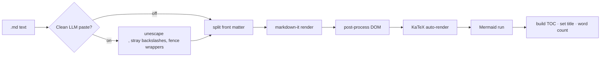

# Press Tools — reference and direction

A collection of small, sharp tools for creatives. Each one does one job, runs locally, and leaves the user more capable than it found them.

Two exist today: **MD Press** (Markdown reader and HTML exporter) and **Mail Press** (HTML email generator). This document is the reference for how they are built, how to ship them, and where the collection goes next — including the path to native macOS apps.

---

## 1. Tenets

These are the rules every Press tool follows. If a feature breaks one, the feature is wrong.

1. **Local first.** The file never leaves the machine unless the user explicitly publishes it. No accounts to read a document.
2. **Single artifact.** One HTML file is the whole app. Zero build step for the core. Dependencies that matter (the parser) are bundled inline; enhancements (fonts, math, diagrams) load from a CDN and degrade gracefully.
3. **Offline is the default state,** not a fallback. The service worker caches the shell on first visit.
4. **The tool teaches.** Every automated step is visible and explainable. A linter says *why* something is flagged. A generator shows what it changed. The user should be able to do the job by hand after using the tool ten times, and choose not to because the tool is faster.
5. **AI is a power tool, not a pilot.** Where a model is involved it is optional, bring-your-own-key, and its output goes through the same inspection as anything pasted in. The user stays the author.
6. **Typeset, don't decorate.** The document is the hero. Chrome is quiet. Every skin is a real palette with light and dark variants, not a filter.
7. **Respect the exit.** Export is always one click and the output is standalone. No lock-in by format.

---

## 2. MD Press

### 2.1 What it is

A browser-native Markdown reader and exporter. Drop `.md` files in, read them typeset, export a self-contained HTML document or print to PDF. Multi-file tabs, live split editor, contents sidebar, seven profession skins plus a custom skin, copy buttons on every block, locked tabs with undo.

### 2.2 Files

| File | Role |
|---|---|
| `index.html` | The entire app: chrome CSS, document CSS (`#doc-css`, also inlined into exports), inline bundle of markdown-it 14 + highlight.js 11, app script |
| `sw.js` | Service worker. App shell is network-first with cache fallback; fonts, KaTeX and Mermaid are cache-first after first use |
| `manifest.webmanifest` | Installable PWA. `file_handlers` so `.md` opens in MD Press from the OS. Share target. Maskable icons |
| `vercel.json` | No-cache header on `sw.js` so updates propagate; security headers |
| `icons/` | 192, 512, 512-maskable, 180 (iOS), SVG favicon |

### 2.3 Render pipeline



Post-process does: task-list checkboxes, table scroll wrappers, external link targets, heading ids and `#` anchors, language labels and copy buttons on `<pre>`, copy buttons on tables (tab-separated) and diagrams (source).

### 2.4 Skins

A skin is one object in the `SKINS` map:

```js
developer: {
  name: 'Developer', desc: 'GitHub-grade palette',
  fonts: [F.geist, F.geist, F.jet],     // body, interface, code
  radius: '6px',
  light: [ /* 16 hex values */ ],
  dark:  [ /* 16 hex values */ ]
}
```

The sixteen tokens, in order: `paper, sheet, ink, ink-2, ink-3, rule, accent, accent-soft, code-bg, on-accent`, then six syntax colors `comment, keyword, string, number, function, variable`.

The **Custom** skin takes four colors (page, sheet, ink, accent) and derives the other twelve, plus a full opposite-mode palette, so a user can never build an unreadable skin. See `derive()` and `customSkin()`.

To add a font: add it to the Google Fonts `<link>` (both places — head and export), add an entry to `F`, add the key to `FONT_CHOICES` and `FONT_NAMES`.

### 2.5 Export

Exported HTML = `#doc-css` + the resolved skin baked into `html[data-theme]` as CSS variables + the rendered article + a ten-line script for copy buttons and back-to-top. Fonts load from Google Fonts. KaTeX CSS is linked only when math is present. Mermaid diagrams are already SVG, so they ship inline.

### 2.6 Ship it

```bash
npx vercel --prod          # from the mdpress/ folder
```

Every release: bump `VERSION` in `sw.js`. Installed users get an "MD Press updated — Reload" toast on their next visit.

### 2.7 Known limits

- Footnotes and definition lists are not enabled (markdown-it plugins; add via the bundle entry and rebuild with esbuild).
- Mermaid is ~3 MB and KaTeX needs its font files, so both stay on CDN. A fully hermetic build is possible at ~4 MB.
- The clipboard **Paste** button needs a secure context (https or localhost); on `file://` it falls back to opening the editor.

### 2.8 Roadmap

| Tier | Feature | Why |
|---|---|---|
| Free | Everything current | The reader is the moat: nothing leaves the machine |
| Pro | **Publish** — one click, doc goes to a shareable URL in the reader's skin, custom domains for teams | First feature that justifies a login. Supabase for storage, one Vercel function |
| Pro | `mdpress` CLI — batch-render a docs folder with the same engine | Pixel-identical to the app. Docs sites in one command |
| Later | Footnotes, definition lists, callout blocks (`> [!NOTE]`) | Common in LLM and GitHub output |

---

## 3. Mail Press

### 3.1 What it is

Paste modern HTML — hand-written or generated by a model from your design — and get a production email: CSS inlined, tables where clients need them, Outlook conditionals, preheader, dark-mode metadata, a plain-text twin, and a linter that explains every flag. Preview at desktop and mobile widths, and in an Outlook simulation that strips what Word's engine can't render.

The generator is deterministic and local. The optional Claude panel (bring your own key) can draft from a brief or rewrite flagged sections, and its output goes through the same compile and lint as anything pasted.

### 3.2 Compile pipeline

```mermaid
flowchart LR
  A[input HTML] --> B[parse to DOM]
  B --> C[extract style blocks]
  C --> D[split: plain rules · @media · @font-face]
  D --> E[inline plain rules by specificity]
  E --> F[attribute mirroring: bgcolor, width, align, border]
  F --> G[wrap: 100% outer table · centered container · MSO conditional]
  G --> H[head: XHTML doctype · metas · MSO xml · media queries]
  H --> I[preheader]
  I --> J[lint + size check]
  J --> K[preview · text twin · export]
```



### 3.3 Why these choices

- **Inline by specificity, in source order.** That is what browsers do, so the inlined result matches what the designer saw. `!important` wins; existing inline styles win last.
- **Media queries stay in `<head>`.** Clients that support them (Apple Mail, iOS, Gmail apps) use them; those that don't ignore them and get the inlined desktop layout.
- **Attribute mirroring.** Outlook reads `bgcolor`, `width`, `align` attributes more reliably than CSS. Both are set.
- **Lint explains.** Each flag says what it is, which clients care, and what to do instead. That is the "tool teaches" tenet.

### 3.4 What it will not do

Convert a flexbox or grid layout into tables automatically. That is a design decision, not a transform, and doing it silently would produce layouts the designer didn't choose. The linter flags it and the Claude panel can propose a table-based rewrite you review.

### 3.5 Roadmap

- Component library: hero, two-column, button, divider, footer — table-based, skin-aware, insertable.
- Send test via Resend (you already run it): one function, API key server-side.
- Client screenshots via a rendering service (Litmus/Email on Acid API) as a Pro feature.

---

## 4. From web tool to macOS app

You have the Apple Developer certificate. This is the path from a single-file web tool to something in the Mac App Store, in the order that gets you shipping fastest.

### 4.1 Phase 1 — SwiftUI shell around the existing app (days)

A native window, native menus, native file dialogs; the tool itself runs unchanged in `WKWebView`.

```swift
// PressShell/ContentView.swift
import SwiftUI
import WebKit

struct ContentView: NSViewRepresentable {
    func makeNSView(context: Context) -> WKWebView {
        let config = WKWebViewConfiguration()
        config.userContentController.add(context.coordinator, name: "press")
        let web = WKWebView(frame: .zero, configuration: config)
        let url = Bundle.main.url(forResource: "index", withExtension: "html", subdirectory: "app")!
        web.loadFileURL(url, allowingReadAccessTo: url.deletingLastPathComponent())
        return web
    }
    func updateNSView(_ view: WKWebView, context: Context) {}
    func makeCoordinator() -> Coordinator { Coordinator() }

    final class Coordinator: NSObject, WKScriptMessageHandler {
        func userContentController(_ c: WKUserContentController, didReceive m: WKScriptMessage) {
            // JS calls window.webkit.messageHandlers.press.postMessage({type:"save", name, html})
            guard let body = m.body as? [String: Any], let type = body["type"] as? String else { return }
            if type == "save", let name = body["name"] as? String, let html = body["html"] as? String {
                let panel = NSSavePanel(); panel.nameFieldStringValue = name
                if panel.runModal() == .OK, let url = panel.url { try? html.write(to: url, atomically: true, encoding: .utf8) }
            }
        }
    }
}
```

Steps:

1. Xcode → new macOS App, SwiftUI, name it `MD Press`. Bundle id `com.shepdesign.mdpress`.
2. Drag the `mdpress/` folder into the project as a **folder reference** (blue folder) named `app`, so `index.html` ships inside the bundle.
3. Add `ContentView` above. In the JS, feature-detect `window.webkit?.messageHandlers?.press` and route Export → native save panel instead of a Blob download.
4. `Info.plist`: declare `CFBundleDocumentTypes` for `net.daringfireball.markdown` and `public.plain-text` so `.md` files open in the app from Finder. Handle `onOpenURL` / `NSApplicationDelegate.application(_:open:)` and pass the file contents into the web view via `evaluateJavaScript`.
5. Sandbox entitlements: `com.apple.security.files.user-selected.read-write`, `com.apple.security.network.client` (for fonts/KaTeX).
6. Menu bar: File → Open (⌘O), Export HTML (⌘S), Print (⌘P) wired to `evaluateJavaScript`.

### 4.2 Phase 2 — native surfaces where they matter (weeks)

Keep the renderer in the web view; go native for the parts users feel:

- Sidebar (tabs, contents) in SwiftUI `NavigationSplitView`.
- Reader settings as a native popover with `ColorPicker` for the custom skin.
- Quick Look extension so `.md` previews in Finder with Space — this alone is a reason to buy.
- Spotlight indexing of opened documents via Core Spotlight.

### 4.3 Phase 3 — full native (optional, months)

Only if performance or App Store review demands it. `swift-markdown` (Apple's) for parsing, `AttributedString` or a `WKWebView` still for layout. Most successful Mac Markdown apps keep a web view for the document. Don't rewrite for purity.

### 4.4 Signing, notarization, distribution

1. **Development:** automatic signing with your team in Xcode.
2. **Direct download (outside the store):** Archive → Distribute App → Developer ID → Notarize. `xcrun notarytool submit` runs in that flow. Staple the ticket: `xcrun stapler staple "MD Press.app"`. Ship as a `.dmg` (use `create-dmg`).
3. **App Store:** Archive → Distribute → App Store Connect. Needs app sandbox, 1024px icon, screenshots at 1280×800 or 2560×1600, privacy manifest (`PrivacyInfo.xcprivacy`) — declare no data collection, which is true and a selling point.
4. **Updates:** App Store handles it. Direct download: Sparkle framework, EdDSA-signed appcast.

### 4.5 One shell, many tools

The shell is generic: it loads `app/index.html` and exposes `save`, `open`, `print`. Every Press tool is the same shell with a different folder. Build the shell once as a Swift package (`PressKit`), and each app is a thin target that depends on it. That is how you get a *collection* without maintaining five codebases.

---

## 5. Working method — how these get built

What worked on MD Press, kept for the rest:

- **Ship the single file first.** Get the tool right in a browser before touching Xcode. The web version is the product; the app is a container.
- **Iterate on screenshots.** A screenshot of the real thing beats a paragraph of description. Every fix in MD Press came from one.
- **Test headless before shipping.** Every build ran through jsdom with the network cut: render, copy buttons, locks, undo, skins, theme toggle. A bug that reaches the user is a test that didn't exist.
- **Patch with asserts.** Changes to the single file are applied as exact-match replacements that fail loudly if the target moved. No silent drift.
- **Bundle what must work; CDN what's nice to have.** The parser is inline. Fonts and diagrams are not. The line is "does the tool do its job without it?"
- **Say less in the chrome.** Every label, tooltip and toast earned its place by answering a question a screenshot raised.

---

## 6. Checklist — your next moves

- [ ] Unzip `mdpress-pwa.zip`, `npx vercel --prod`, point a domain. **Day one.**
- [ ] Domain and name check. `mdpress` is near WordPress naming space; decide before buying.
- [ ] Open `mail-press.html`, paste an AI-generated email design, read every lint flag once. That is the fastest way to learn what email clients actually do.
- [ ] Xcode: new macOS app, folder reference to `mdpress/`, `WKWebView` shell from §4.1. Aim for "opens a `.md` from Finder" as the first milestone.
- [ ] Extract the shell into `PressKit` once the second tool needs it.
- [ ] Decide the first paid feature. Publish (MD Press) or Send-test-via-Resend (Mail Press) — both are one function each.
