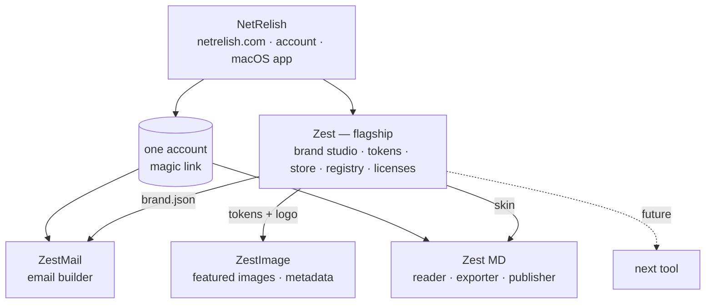

# Zest

Zest is a brand system you build once and every tool inherits. The flagship at `zest.netrelish.com` is the brand studio itself (Brandforge, grown up). The tools — **Zest MD**, **ZestMail**, **ZestImage** — take the tokens and make things with them.

| Layer | Name | Where |
|---|---|---|
| Parent brand | **NetRelish** | netrelish.com |
| Flagship | **Zest** (was Brandforge) — the brand studio: palette, type, tokens, and the store | zest.netrelish.com |
| Tool | **ZestMail** (was Mail Press) — email builder for every brand you run | zest.netrelish.com/mail |
| Tool | **Zest MD** (was MD Press) — Markdown reader, exporter, publisher | zest.netrelish.com/md |
| Tool | **ZestImage** (new) — branded featured images with metadata, no generative art | zest.netrelish.com/image |

Stack: Vercel (store, apps, API), Supabase (accounts, licenses, cloud data), S3 (assets and published pages), Stripe (checkout, subscriptions, tax), Resend (magic links and test sends), Anthropic API (metered assistance). Every one of these you already run.

---

## 1. The model in one paragraph

The core of each tool stays **free and local** — that's the product's honesty and its marketing. You cannot copy-protect a single HTML file, so don't try. What you sell is everything the local file *can't* do on its own: cloud brands and designs that follow you across machines, image hosting, publishing to a link, sending tests, team seats, metered model assistance, and the native macOS shell. A license is a signed entitlement the apps check; the cloud features refuse to work without it. The local core never asks.

Why this works: users try the real thing with no signup, hit a wall exactly where the value is (I want this on my other Mac; I want a link; I want the image hosted), and the upgrade is one click in the tool they're already using.

---

## 2. Brand architecture



**Naming.** Zest with no suffix is the studio and the store. Tools are one-word compounds: ZestMail, ZestImage. Zest MD keeps the space because "ZestMD" reads as a typo.

**Naming inside the tools.** The tools keep their internal names in code (`mailpress`, `mdpress`) — renaming identifiers buys nothing. The user-facing names change: title bar, brand mark, empty states, exports (`<meta name="generator" content="Zest MD">`), toasts. One `PRODUCT` constant per app.

**Voice.** Bright, quick, plain. Zest is the small thing that makes the whole dish better — the tools should feel like that: fast, sharp, never in the way. No metaphors in the UI; a button says what it does.

**Trademark check before launch:** search USPTO TESS and a plain web search for "Zest", "ZestMail" and "Zest MD" in software/SaaS. "Zest" alone is common, which is fine for a product line under NetRelish; the compound names are what you'd defend. Two minutes each; do it before the domain and store copy exist.

---

## 2.1 Positioning — against Lovart and the AI design agents

Lovart, and the wave behind it, sell "upload a brand guide, one prompt, fifty on-brand assets" — generated by image and video models, paid in credits. Same category as Zest (brand kit in, assets out), opposite method. Say the difference in the first sentence of the store:

> **Zest composes. It doesn't generate.** Your brand is a set of tokens — colour, type, spacing, logo — and every tool builds from them. No model in the loop, so nothing ever looks like a prompt.

What that buys the customer, in their words:

- *It looks like us, not like AI.* Every asset is typography, colour and structure from their system. Photos are theirs, tinted to the palette, never invented.
- *It's the same every time.* Same tokens, same output. Rebrand once and regenerate the set — Lovart can't promise that with a diffusion model.
- *I keep it.* Tokens export to CSS, Tailwind, Figma, Bricks, `theme.json`. The work isn't trapped in a canvas.
- *It runs here.* The core is local. Cloud is for sync and publishing, not for making the thing.
- *It does email and documents.* They don't.

What not to chase: image generation, video, product shoots, style transfer, upscaling. Those are model features, and the customer who wants them is not the customer who wants Zest.

Borrow two things: the **count** in the headline (one title → every target; one brand → twelve headers), and the **saved-workflow concept** — theirs are "skills," ours are **Recipes**: a saved module in ZestMail, a layout in ZestImage, a skin in Zest MD, one name across the line.

The buyer: designers whose clients have said "this looks like AI," and developers who want tokens rather than pictures. Growing, underserved, and already what every section below is built for.

## 3. Tiers and pricing

Suggested, not decided. Anchor: Stripo is $15–$45/mo, Beefree $30+/mo, MDHero is a one-time desktop purchase. You're cheaper than the email tools because you're one person with no support desk, and you're more than a reader because Zest MD publishes.

| | Free | Zest Pro | Zest Suite |
|---|---|---|---|
| Price | $0 | $9/mo · $79/yr · $179 lifetime | $15/mo · $129/yr · $299 lifetime |
| Local core: build, edit, lint, export, skins, brands | ✓ unlimited | ✓ | ✓ |
| Saved designs / docs | this browser only | cloud, all devices | cloud, all devices |
| Brands (ZestMail) | 1 | unlimited | unlimited |
| Zest studio: palettes, pairings, scales, exports | ✓ unlimited | ✓ | ✓ |
| Zest studio: saved brand systems, custom font library (cloud) | this browser | ✓ | ✓ |
| Zest → tool handoff (brand, skin, image kit) | ✓ | ✓ | ✓ |
| ZestImage: layouts, ratios, PNG/WebP export | ✓ watermark-free, 3 brands | ✓ | ✓ |
| ZestImage: batch, SVG export, metadata writer, S3 upload | — | ✓ | ✓ |
| Image hosting to S3 (ZestMail) | — | ✓ 2 GB | ✓ 5 GB |
| Publish to link (Zest MD) | — | ✓ | ✓ custom domain |
| Test send via Resend (ZestMail) | — | ✓ | ✓ |
| Model assistance | bring your own key | 200 drafts/mo included | 500 drafts/mo included |
| Modules and templates library | local | cloud, shared | cloud, shared |
| Team seats | — | +$5/seat | 3 included |
| NetRelish macOS app | — | ✓ | ✓ |
| Support | community | email | email, priority |

Lifetime = one major version line, updates for a year, then a paid upgrade. Say so on the pricing page; it's standard and it's honest.

**Stripe products:** one product per tool with three prices (monthly, yearly, lifetime), one "Zest Suite" product with three prices, one "seat" price. Stripe Tax on. Customer portal for cancel/upgrade so you never handle it by hand.

---

## 4. Licensing architecture

### 4.1 Principle

An entitlement is a **signed JWT** (Ed25519) issued by the license service and stored in the app. Apps verify it **offline** with the public key baked into the file. So Pro features work on a plane, and the check can't be defeated by blocking a network call — there's nothing to block. Tokens are short-lived (30 days) with a 14-day offline grace; the app refreshes silently whenever it's online.

```json
{
  "sub": "user_01J…",            // NetRelish account id
  "email": "ryan@shepdesign.com",
  "tools": ["mail", "md"], // or ["*"] for Suite
  "tier": "pro",                  // pro | canteen
  "seats": 1,
  "quota": { "drafts": 200, "storage_gb": 2 },
  "iat": 1758240000,
  "exp": 1760832000,
  "device": "sha256(device fingerprint)"
}
```

### 4.2 Flow

```mermaid
sequenceDiagram
  participant U as User (in ZestMail)
  participant S as Store / API (Vercel)
  participant St as Stripe
  participant DB as Supabase
  U->>S: Upgrade → Stripe Checkout (email prefilled)
  S->>St: create checkout session (price, metadata: tool)
  St-->>S: webhook checkout.session.completed
  S->>DB: upsert user, create license (tool, tier, status=active, stripe ids)
  S->>U: magic link email (Resend) "Your Zest tools are ready"
  U->>S: click link → session cookie
  U->>S: GET /api/license/token
  S->>DB: read active licenses
  S-->>U: signed JWT (30 days)
  U->>U: verify with embedded public key → unlock Pro features
  Note over U,S: token refreshed on any online launch; 14-day offline grace
  St-->>S: webhook subscription.deleted / payment_failed
  S->>DB: status=past_due → next token refresh returns tier=free
```

### 4.3 In-app gating

Every Pro feature runs through one function:

```js
// packages/zest-core/license.js
export function can(feature) {          // 'cloudSync' | 'imageUpload' | 'publish' | 'testSend' | 'drafts' | 'team'
  const t = currentToken();             // null when free
  if (!t) return { ok: false, reason: 'upgrade' };
  if (t.exp * 1000 < Date.now() - GRACE_MS) return { ok: false, reason: 'refresh' };
  if (!(t.tools.includes(TOOL_ID) || t.tools.includes('*'))) return { ok: false, reason: 'wrongTool' };
  return { ok: true, quota: t.quota };
}
```

When `can()` says no, the UI shows the feature, greyed, with a one-line reason and an Upgrade button that opens Checkout with the email prefilled. Never hide Pro features from free users — seeing them is the sales page.

### 4.4 Device and seat rules

- A license allows **3 devices** per seat, tracked by a fingerprint stored in the token. Fourth device gets "sign out another device" in the account page. Don't be strict; be visible.
- Teams: the owner invites by email; each invitee gets their own token scoped to the owner's license. Seats are counted at token issue.

---

## 5. Cloud services (what Pro actually buys)

### 5.1 Data model (Supabase)

| Table | Key columns |
|---|---|
| `users` | id, email, name, created_at, stripe_customer_id |
| `licenses` | id, user_id, tool (`mail`/`md`/`*`), tier, status, seats, stripe_subscription_id, current_period_end, lifetime (bool) |
| `devices` | id, user_id, fingerprint, name, last_seen |
| `team_members` | license_id, user_id, role |
| `brands` | id, owner_id, license_id, name, json (the brand object), updated_at |
| `designs` | id, owner_id, tool, name, json, updated_at, deleted_at |
| `modules` | id, owner_id, tool, name, json |
| `documents` | id, owner_id, title, markdown, html (rendered), skin, updated_at |
| `publications` | id, document_id, slug, s3_key, domain, public (bool), views |
| `assets` | id, owner_id, tool, s3_key, bytes, mime, created_at |
| `usage` | user_id, month, drafts_used, storage_bytes |

Row-level security on `owner_id`; team members read via a join on `team_members`. Supabase Auth is **not** used for login (magic links come from your own Resend flow so the email is branded); Supabase is the database only, accessed from Vercel functions with the service key.

### 5.2 API (Vercel functions, `/api/*`)

| Endpoint | Does |
|---|---|
| `POST /api/auth/magic` | Send magic link (Resend). Rate-limited by email + IP |
| `GET /api/auth/callback` | Verify link, set httpOnly session cookie |
| `GET /api/license/token` | Issue signed entitlement for the session |
| `POST /api/stripe/checkout` | Create Checkout session |
| `POST /api/stripe/webhook` | Provision, renew, suspend |
| `GET /api/stripe/portal` | Customer portal link |
| `GET/PUT /api/sync/:kind` | brands, designs, modules, documents — last-write-wins with `updated_at`, conflicts surfaced in-app |
| `POST /api/assets/sign` | Presigned S3 PUT for an image; enforces mime, size, and the storage quota |
| `POST /api/publish` | Render Markdown server-side with the same engine, write to S3, return URL |
| `POST /api/send/test` | Resend test send of compiled email to the account email (ZestMail) |
| `POST /api/claude` | Metered proxy — checks `usage.drafts_used` against quota, then forwards. This replaces the proxy-token version |
| `GET /api/registry` | Tool registry for NetRelish (§6) |

### 5.3 S3 layout

Three buckets, one region, all private with presigned access except `pub`:

| Bucket | Holds | Access |
|---|---|---|
| `zest-assets` | ZestMail images: `u/{user_id}/{asset_id}.{ext}` | Presigned PUT from the app; public-read GET via CloudFront so emails can link to them |
| `zest-pub` | Zest MD publications: `p/{slug}/index.html` | Public via CloudFront; custom domains as CloudFront aliases |
| `zest-backup` | Nightly Supabase dumps | Private |

CloudFront in front of both public buckets: `assets.zest.netrelish.com` and `pub.zest.netrelish.com`. Email clients load images from a real domain with a real cert, and the S3 bucket name never appears in a customer's email.

### 5.4 Model assistance

Free users bring their own key (the current Direct route). Pro users get the metered proxy with no key at all. Store the count in `usage`; show "137 of 200 drafts this month" in the panel. When the quota's gone, offer bring-your-own-key as the fallback rather than a hard stop.

---

## 6. NetRelish integration — "official tools"

Two integrations, one protocol.

### 6.1 The tool protocol

Every tool ships a manifest next to its HTML:

```json
{
  "id": "mail",
  "name": "ZestMail",
  "version": "3.1.0",
  "tagline": "Emails for every brand you run",
  "entry": "https://zest.netrelish.com/mail/index.html",
  "icon": "https://zest.netrelish.com/mail/icon-512.png",
  "fileTypes": [".html", ".mailpress.json"],
  "capabilities": ["open", "save", "clipboard", "license", "network"],
  "minShell": "1.0.0",
  "changelog": "https://zest.netrelish.com/mail/changelog"
}
```

The registry at `/api/registry` lists every tool's manifest. NetRelish reads it to show the tools it can offer; the store reads it to render product pages. One source of truth.

### 6.2 The bridge — `window.netrelish`

When a tool runs inside NetRelish (macOS app, or the NetRelish web shell), the host injects a small object before the page loads. Tools feature-detect it and prefer it; when it's absent they fall back to browser behaviour. This is the same pattern as the `window.webkit.messageHandlers` shell in PRESS-TOOLS.md §4, formalised:

```ts
interface NetRelishBridge {
  version: string;
  license: { token(): Promise<string | null> };         // host holds the entitlement; tools never store it themselves
  files: {
    open(accept: string[]): Promise<{ name: string; text: string }[]>;   // native open panel
    save(name: string, text: string, mime: string): Promise<boolean>;    // native save panel
  };
  clipboard: { write(text: string): Promise<void> };
  ui: { toast(msg: string): void; setTitle(t: string): void };
  events: { on(name: 'fileOpened' | 'themeChanged', fn: (payload: any) => void): void };
}
```

What this buys: one login in NetRelish, every tool licensed; `.md` and `.mailpress.json` files open from Finder into the right kit; native save panels; menu-bar commands. What it costs: about 200 lines of Swift in the shell (PressKit) and a `bridge.js` shim of similar size in each tool.

### 6.3 Three surfaces, same file

| Surface | What runs | Login | Files |
|---|---|---|---|
| **Browser** at zest.netrelish.com | The single HTML file, served by Vercel | Magic link cookie | Browser download / upload |
| **NetRelish macOS app** | Same file, cached locally by PressKit, updated from the registry | Host session, shared across tools | Native panels, Finder file types, Quick Look (Zest MD) |
| **Installed PWA** (fallback for non-Mac) | Same file via service worker | Magic link cookie | File System Access API where available |

Never fork the file per surface. Feature-detect `window.netrelish`, then the PWA APIs, then plain browser.

---

## 7. Tool specs

### 7.1 ZestMail

Everything in MAIL-PRESS.md is the free core, minus these moves:

| Feature | Free | Pro |
|---|---|---|
| Brands | 1 | Unlimited, cloud, shared with team |
| Designs, modules | local | cloud |
| Image fields | URL only | **Upload** button → presigned S3 → CloudFront URL pasted back. Drag an image onto an Image block to upload |
| Test send | — | "Send test to me" — compiled HTML through Resend from `test@zest.netrelish.com`, tags rendered with sample values |
| Model assistance | own key | metered, no key |
| Bento | copy/paste | **Push to Bento** if their API supports template creation — investigate; ship copy/paste first and don't promise this on the pricing page until it works |
| Platforms | Bento, plain, custom | + Klaviyo, Mailchimp, ConvertKit tag sets (a data file, not code) |

Pricing-page one-liner: *Build the email once. Ship it to every brand.*

### 7.2 Zest MD

Everything in PRESS-TOOLS.md §2 is the free core:

| Feature | Free | Pro |
|---|---|---|
| Read, skins, export, print | ✓ | ✓ |
| Documents | this browser | cloud, all devices |
| **Publish** | — | One click → `pub.zest.netrelish.com/{slug}` in the reader's skin, with the reader's controls. Unpublish, update in place, view count. Suite tier: custom domain |
| CLI (`md build docs/ --out site/`) | — | ✓ same engine, same output |
| Quick Look extension (macOS) | — | ✓ via NetRelish app |
| Footnotes, definition lists, callouts | ✓ | ✓ (ship free; it's parser config) |

Pricing-page one-liner: *Read Markdown like it was typeset. Publish it when you're ready.*

### 7.3 Zest (the studio)

Brandforge as it stands is the free core: OKLCH colour engine with gamut mapping, six harmonies, role-based swatches with locks, 12 presets, 19 curated pairings from 38 Google Fonts, custom font upload (FontFace API, IndexedDB), modular type scale, spacing scale with density, radius tokens, button sizes and shapes, live light/dark preview on a fictional brand, WCAG audit, exports as CSS variables, Tailwind config, JSON, and `@font-face`.

| Feature | Free | Pro |
|---|---|---|
| Everything above | ✓ | ✓ |
| Brand systems | this browser, URL-hash share links | cloud, named, versioned; shared with team |
| Custom fonts | this browser (IndexedDB) | cloud font library, reused across tools and devices |
| **Send to ZestMail** | ✓ creates or updates a ZestMail brand from the tokens | ✓ |
| **Send to Zest MD** | ✓ creates a custom skin from the tokens | ✓ |
| **Send to ZestImage** | ✓ tokens plus logo become an image kit | ✓ |
| Exports | CSS, Tailwind, JSON, font-face | + Figma variables JSON, Bricks global CSS classes, WordPress `theme.json` |
| Brand sheet | — | one-page PDF / HTML brand sheet with palette, ramp, type specimen, contrast audit — the client-facing deliverable |
| Font pairing suggestions | curated list | model-assisted ("three pairings for a law firm that isn't boring"), metered |

Pricing-page one-liner: *Pick the colours and type once. Every tool inherits them.*

**The handoff is the product.** A `zest-brand.json` file is the interchange between tools:

```json
{
  "zest": 1,
  "name": "Shepdesign",
  "fonts": { "head": "Bricolage Grotesque", "body": "Geist", "mono": "Geist Mono", "googleFontsUrl": "…", "custom": [] },
  "light": { "primary": "#1f4ed8", "ink": "#1b2130", "muted": "#4b5363", "paper": "#f2f3f5", "sheet": "#ffffff", "line": "#dde0e6", "dark": "#1b2130" },
  "dark":  { "primary": "#8fb0ff", "ink": "#e7e9ee", "muted": "#b4bac6", "paper": "#111419", "sheet": "#181c22", "line": "#2a3039", "dark": "#0f1420" },
  "ramp": ["#eef2fd", "…", "#0a1f5c"],
  "radius": 8,
  "type": { "base": 16, "ratio": 1.25 },
  "spacing": { "unit": 4, "density": "comfortable" },
  "buttons": { "size": "md", "shape": "rounded" }
}
```

ZestMail reads `light` (its brands are single-mode: email) plus `fonts.body`, `radius`, and the identity fields it already has. Zest MD reads `light` and `dark` into its custom skin plus `fonts` into its typeface picker. ZestImage reads everything plus `logo`. Zest writes it; the tools import it, and — with Pro — pick it up automatically from the cloud when the same account opens them. In NetRelish, "Send to ZestMail" is a bridge call; in the browser it's a download and an import button until cloud sync lands.

Roles map one-to-one on purpose. Zest's four role swatches become `primary`, `ink`, `paper` (surface) and `dark` (panel); `muted`, `sheet` and `line` are derived the same way ZestMail's custom skin already derives them. No translation layer to maintain.

---

### 7.4 ZestImage

Branded featured images — blog hero, OG card, social tile — composed from the brand system, not generated. No stock, no diffusion, no "AI art" look. The image is typography, colour, the logo, and structure. That is the selling point, said out loud on the page: *your brand, not a robot's idea of it.*

**Inputs:** a `zest-brand.json` (or a brand chosen from the cloud), a title, an optional kicker and byline, an optional photo the user supplies (their own — cropped and tinted to the palette, never invented).

**Layouts (v1, eight):** Title card · Kicker + title · Split (text left, photo right) · Photo with gradient scrim and title · Stat card (one big number) · Quote card · Numbered series (Part 3 of 7) · Logo lockup only. Each layout is a small template function over the tokens, the same way ZestMail blocks are. New layouts are one function each.

**Ratios and targets (one click renders all):**

| Target | Size | Notes |
|---|---|---|
| Open Graph / Twitter large | 1200×630 | Safe zone drawn on the canvas |
| Blog featured | 1600×900 | Also 1200×675 |
| Square | 1080×1080 | Instagram, LinkedIn |
| Portrait | 1080×1350 | Instagram portrait |
| Story / Reel | 1080×1920 | |
| Pinterest | 1000×1500 | |
| Custom | any | |

**Rendering:** SVG composed in the browser → rasterised with `canvas` to PNG/WebP at 1× and 2×. The SVG is also an export (Pro), which means the same image is editable later in Illustrator or Figma. Fonts come from the brand: Google Fonts embedded as `@font-face` in the SVG, custom fonts from the Zest font library.

**Metadata — the part the "cheesy" tools skip:**

- Filename from a pattern: `{brand}-{slug}-{target}.{ext}` — `shepdesign-zest-launch-og.png`. Lowercase, hyphens, no dates unless asked.
- **Alt text** field, required before export, pre-filled from title + kicker and editable. Exported alongside as `alt.txt` and in the JSON manifest.
- **XMP/EXIF written into the file** (Pro): title, description, creator (brand company), copyright line, keywords, and `dc:source` = the brand id. Done client-side with a small XMP writer; PNG gets an `iTXt` chunk, WebP gets an `XMP ` chunk, JPEG gets APP1.
- **OG snippet** copied with the image: `og:image`, `og:image:width/height`, `og:image:alt`, `twitter:card`. Paste into the page head; done.
- **Manifest** `zest-image.json` per export batch: every file, its target, dimensions, alt text, and the brand version it was made from, so a rebrand can regenerate the whole set (Pro: "Regenerate all from brand v3").

**Free vs Pro**

| Feature | Free | Pro |
|---|---|---|
| All layouts, all ratios, PNG and WebP at 2× | ✓ | ✓ |
| Brands | 3 | unlimited, cloud |
| Batch: one title → every target | — | ✓ |
| SVG export | — | ✓ |
| XMP/EXIF metadata writer | filename + alt.txt | ✓ embedded |
| Upload to S3 → CloudFront URL | — | ✓ pasteable into ZestMail Image blocks and Zest MD docs |
| Regenerate from brand version | — | ✓ |
| Series mode: one design, twelve titles from a list | — | ✓ |

**Ties to the other tools:** ZestMail's Image and Hero blocks get a "Make with ZestImage" button that opens ZestImage with the brand and block title prefilled and returns the CloudFront URL. Zest MD's Publish uses ZestImage to make the OG card for a published document automatically. That second one is the demo: publish a doc, get a branded share card without touching anything.

Pricing-page one-liner: *Featured images that look like your brand, not like a prompt.*

## 8. Repository and deployment

One monorepo, one Vercel project per app, shared packages.

```
zest/
  apps/
    store/          pricing, account, changelogs, docs — served under /pricing, /account, /changelog
    mail/         index.html + sw.js + manifest + zest.json      → /mail
    md/       index.html + sw.js + manifest + zest.json      → /md
    zest/           index.html + sw.js + manifest + zest.json      → /  (the studio is the home page; store pages live beside it)
    image/          index.html + sw.js + manifest + zest.json      → /image
  api/              Vercel functions (one deployment, shared by all apps)
  packages/
    zest-core/       license.js (verify, can), bridge.js (window.netrelish shim), sync.js, telemetry-off.js
    email-engine/   the compiler + linter, published so the CLI and test-send share it
    md-engine/      markdown-it config + doc CSS, shared with the CLI and /api/publish
    brand-schema/   zest-brand.json schema + import/export helpers used by every tool
    image-engine/   layout functions, SVG composer, raster + metadata writers (XMP/EXIF), shared with /api/publish for OG cards
  presskit/         Swift package (keep the name; it's internal): WKWebView shell, bridge host, file types, updater
  infra/            S3 bucket policies, CloudFront configs, Supabase migrations
```

Vercel: `zest.netrelish.com` (store + `/mail` + `/md` via rewrites) and the API under `/api`. CNAME the subdomain from wherever netrelish.com's DNS lives to Vercel. One env var set:

```
ANTHROPIC_API_KEY  STRIPE_SECRET  STRIPE_WEBHOOK_SECRET  STRIPE_PRICE_*  
SUPABASE_URL  SUPABASE_SERVICE_KEY  
RESEND_API_KEY  
AWS_ACCESS_KEY_ID  AWS_SECRET_ACCESS_KEY  AWS_REGION  S3_ASSETS  S3_PUB  CF_ASSETS_DOMAIN  CF_PUB_DOMAIN  
LICENSE_PRIVATE_KEY (Ed25519, PEM)  SESSION_SECRET
```

The public half of `LICENSE_PRIVATE_KEY` is a constant in `zest-core/license.js`. Rotate by shipping a new constant and accepting both for 60 days.

---

## 9. Legal and operations

- **EULA / Terms:** per-user license, 3 devices per seat, no resale, lifetime = one major version with 12 months of updates. Cloud data is yours; you can export everything (designs as `.json`, documents as `.md`, assets as a zip) from the account page at any time. Put that export button in before launch — it's the strongest trust signal you can ship.
- **Privacy:** the free local core collects nothing and phones nowhere; say it plainly. Pro stores what the table in §5.1 says and nothing else. No analytics scripts in the apps. Store page analytics: server-side counts only.
- **Refunds:** 14 days, no questions, through the Stripe portal. It costs you almost nothing and removes the last objection.
- **Support:** one address, `hello@netrelish.com`, and a public changelog. Answer within a business day. Say that on the pricing page and keep it.
- **Taxes:** Stripe Tax handles VAT/GST/sales tax. Shepdesign LLC is the merchant of record.
- **Model use:** the metered proxy logs counts, never content. State that.

---

## 10. Launch plan

**Milestone 1 — Store live, licenses real (2 weeks)**
- [ ] Rename UI strings in all apps (Brandforge → Zest); new marks; `zest.json` for each
- [ ] `zest-brand.json` schema; export from Zest; import in ZestMail (Brand tab) and Zest MD (custom skin)
- [ ] Monorepo, Vercel project, subdomain CNAME
- [ ] Supabase schema from §5.1; Ed25519 keypair; `/api/license/token`
- [ ] Stripe products and prices; Checkout; webhook provisioning; portal
- [ ] Magic-link auth via Resend
- [ ] `can()` gating in both apps with upgrade prompts
- [ ] Pricing page, terms, privacy, refund policy, changelog
- [ ] Account page with **Export everything**

**Milestone 2 — The Pro features (3 weeks)**
- [ ] Cloud sync of brands, designs, modules, documents
- [ ] ZestMail: presigned S3 image upload + CloudFront
- [ ] ZestMail: test send via Resend
- [ ] Zest MD: Publish to S3 + CloudFront with slug, update, unpublish
- [ ] Metered Claude proxy with quota display
- [ ] Zest studio: cloud brand systems and font library; brand sheet PDF; Bricks / theme.json / Figma exports
- [ ] ZestImage v1: eight layouts, all targets, PNG/WebP 2×, filename pattern, alt text, OG snippet, manifest
- [ ] ZestImage Pro: batch, SVG, XMP/EXIF writer, S3 upload, series mode; Zest MD Publish makes OG cards with it

**Milestone 3 — NetRelish (3 weeks)**
- [ ] PressKit Swift package: bridge host, file types, registry-driven kit updates
- [ ] NetRelish app lists tools from `/api/registry`, one login unlocks all
- [ ] Zest MD Quick Look extension
- [ ] Notarised direct download; App Store submission after

**Milestone 4 — After launch**
- [ ] Custom domains for Publish
- [ ] Teams
- [ ] Zest MD CLI
- [ ] Push to Bento (only if the API allows it)
- [ ] Next tool

---

## 11. Decisions you need to make

1. Prices — the table in §3 is a starting point.
2. Lifetime licenses: offer them or not. They sell well to your audience (designers hate subscriptions) and cap your upside. I'd offer them.
3. Whether NetRelish.com itself sells the tools or only links to Zest. Simpler: one store, at zest.netrelish.com; netrelish.com has a "Zest" nav item that points there.
4. Trademark results on the names.
5. Decided: the studio is the home page. The first screen a visitor sees is the palette tool, working, no signup. Tools are a row underneath it.
6. ZestImage's name is fine. If you want a second option, **ZestCard** says "OG card" more directly but undersells blog heroes. Keep ZestImage.
